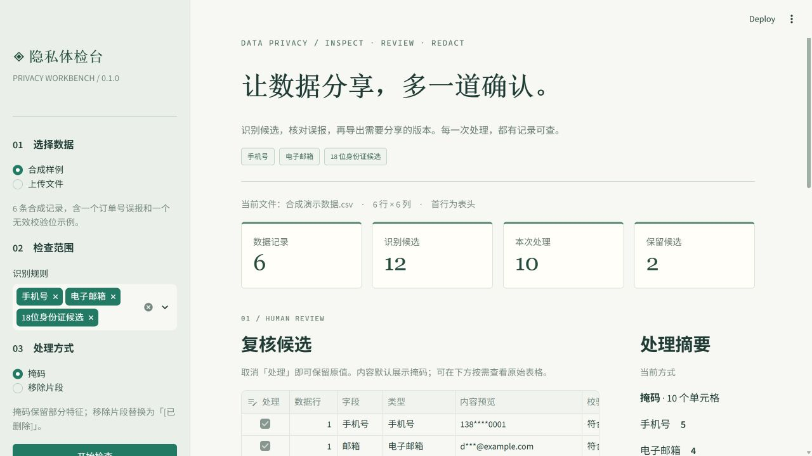

# ◈ 中文敏感数据体检台

**Data Privacy Workbench** — 为 CSV / Excel 分享前增加一次可复核的隐私检查。

[](https://github.com/LINXsoserious/data-privacy-workbench/actions/workflows/tests.yml)



上传表格 → 检查手机号、邮箱和身份证候选 → 取消误报 → 掩码或移除片段 → 下载处理结果与报告。

Python 3.11+ · Streamlit · 无模型调用 · 无 API 密钥 · Apache-2.0

## 直接体验

启动后默认载入 **6 条合成记录**。点击「开始检查」，得到 12 个候选，其中 11 个默认勾选、1 个无效校验位候选默认保留。

演示中有两个刻意保留的边界：

1. 第 3 条数据中的订单号 `13812345678` 符合手机号格式，却是业务编码。取消其「处理」勾选，观察处理数从 11 变成 10、保留候选从 1 变成 2。
2. 第 4 条数据的证件候选校验位不匹配，默认不处理；可以根据实际用途决定是否仍需移除。

示例标记为合成数据；证件示例使用未核实的 `999999` 行政区段，仅用于演示结构与校验位检查。它不表示真实签发的身份证号码。

已提供与截图状态对应的 [处理后 CSV](docs/demo-output/redacted_data.csv) 和 [检查报告 JSON](docs/demo-output/privacy_report.json)，不运行应用也能先查看输出格式。

## 运行

```powershell
python -m venv .venv
& .\.venv\Scripts\python.exe -m pip install -r requirements.txt
& .\.venv\Scripts\python.exe -m streamlit run app.py
```

也可以在 Windows PowerShell 中运行 `./run.ps1`：首次创建项目虚拟环境并安装依赖，以后直接启动。安装依赖需要联网，应用的数据处理不需要网络连接。

macOS / Linux：

```bash
python3 -m venv .venv
. .venv/bin/activate
python -m pip install -r requirements.txt
python -m streamlit run app.py
```

## 与上游示例相比改了什么

基于 [awesome-llm-apps / AI Data Analysis Agent](https://github.com/Shubhamsaboo/awesome-llm-apps/tree/6c16b23f1bacd0fdf240bb5141ef45e59e82c306/starter_ai_agents/ai_data_analysis_agent) 的上传与 Streamlit 交互思路重新组织实现。

| 内容 | 上游示例 | 本项目 v0.1 |
| --- | --- | --- |
| 主要用途 | 自然语言数据分析 | 分享前的敏感信息检查与处理 |
| 执行依赖 | GPT-4o、Agno、DuckDB 工具 | 确定性规则、Pandas、OpenPyXL |
| 文件处理 | 转换类型并写入临时 CSV | 内存处理，保留 CSV 文本编号与字面 NA |
| 复核 | 没有隐私候选复核流程 | 每个候选可单独取消，显示检查理由 |
| 脱敏 | 未实现 | 掩码 / 移除命中片段，多命中不修改其他文字 |
| 导出 | 分析回答与界面展示 | 专用 CSV 下载按钮防护公式起始字符；JSON 记录处理选择 |
| 验证 | 示例应用 | 核心行为测试与 Streamlit 界面流程测试 |

未改动的上游代码保存在 `docs/upstream/ai_data_analyst.py.txt`，仅供对照，不作为应用执行代码。上游采用 Apache-2.0，本项目保留同一许可证及来源说明，见 `LICENSE`、`NOTICE`。

## 功能

- CSV：UTF-8 / UTF-8 BOM、GB18030、带 BOM 的 UTF-16；逗号分隔，首行为唯一非空列名。
- XLSX：读取首个工作表，公式作为文本读取；不支持旧版 XLS。
- 手机号：大陆手机号格式，可带 `86` / `+86`。
- 邮箱：常见 ASCII 邮箱，包括混合文本、句末标点场景。
- 身份证候选：18 位结构，检查出生日期及校验位，不核验行政区或真实身份；无效项仅列为疑似。
- 在单元格内按位置替换，支持一格多处命中与原文对照。
- 调整规则或更换数据会丢弃旧检查结果，防止套用陈旧位置。
- 下载的 JSON 不复制原始完整命中值、文件名或列名；只记录数据行和列序号、类别、掩码预览、处理选择与规则说明。
- 专用 CSV 导出为 UTF-8 BOM，对公式起始字符和控制字符加文本前缀；这会有意改变相关文本的导出表示。

## 数据处理范围

上传内容只在当前应用会话中处理，不自动保存上传文件，不调用模型或外部分析服务，也不使用跨会话数据缓存。浏览器连接运行 Streamlit 的服务器；若以后公开部署，上传数据将发送到该服务器，不能称为浏览器端处理。

单文件最多 5 MB、20,000 数据行、50 列、100,000 个数据单元格；单字段最多 10,000 字符；候选最多 10,000 个。超限时拒绝本次检查，不静默截断。XLSX 另限制解压后体积与内部文件数。

规则匹配会有误报与漏报。本版不覆盖姓名、地址、银行卡号、图片等所有敏感信息，候选为零不代表不存在敏感信息。掩码仍保留部分特征，也不能作为匿名化证明。未勾选的候选会在处理后表格和导出 CSV 中保留原值。

Excel 已按数值存储而丢失的前导零或长编号精度，应用无法恢复；需要源文件按文本保存这类字段。

## 测试

```bash
python -m unittest discover -s tests -v
```

测试不调用网络或模型，包括识别边界、校验失败、误报取消、位置过期、源数据不变、输入保真、输入上限、公式导出、界面扫描和处理方式切换。GitHub Actions 使用同一命令。详细本地验证记录见 [docs/verification.md](docs/verification.md)。

## 项目结构

```text
app.py                         Streamlit 界面
privacy_workbench/
  detection.py                 规则、校验、按片段脱敏
  files.py                     CSV / XLSX 读取、受控导出
  reporting.py                 检查报告
sample_data/                   合成样例及生成脚本
tests/                         核心与界面测试
docs/                          来源、截图、实现与验证记录
.github/workflows/tests.yml    CI
```

## 作品说明

这是一次基于开源示例的工程二次开发；v0.1 的代码、文档和初始测试由 AI 辅助生成并在本地验证。用户本人独立理解、修改和运行的部分，应据后续实际记录补充，不能由自动生成的材料代替。

当前版本是规则工具，不包含训练过的模型或自主 Agent。适合作为后续 RAG 文档入库检查模块的起点；真实生产数据上的识别质量尚未评测。

## 后续可选的小迭代

- 为具体数据集补充带标注的漏报与误报案例，并分别报告准确率和召回率。
- 增加整列处理与自定义规则，而不是持续叠加更多框架。
- 将同一检查模块接入 RAG 文档入库流程，保留处理来源和版本。

这些是后续方向，不属于本版已经实现的功能。
