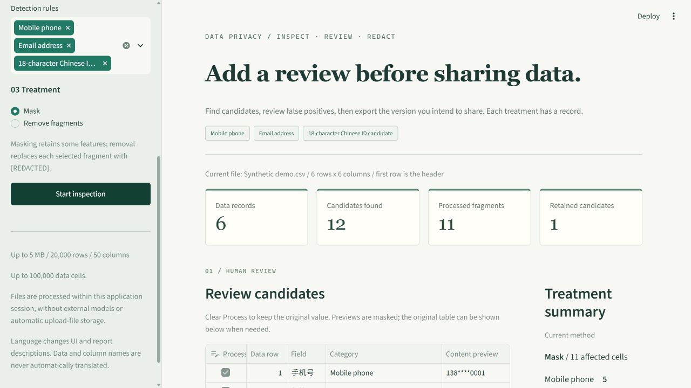

# ◈ Data Privacy Workbench

**English** | [简体中文](README.zh-CN.md)

A reviewable privacy check before sharing CSV / Excel files: find candidates, reject false positives, mask or remove selected fragments, then download the processed table and an inspection report.

[](https://github.com/LINXsoserious/data-privacy-workbench/actions/workflows/tests.yml)



The [Chinese screenshot](docs/screenshot.png) preserves the v0.1 interface record. Version 0.2 supports both languages from the sidebar.

Python 3.11+ · Streamlit · v0.2.0 · No model calls · No API keys · Apache-2.0

## Install and run

Windows PowerShell:

```powershell
python -m venv .venv
& .\.venv\Scripts\python.exe -m pip install -r requirements.txt
& .\.venv\Scripts\python.exe -m streamlit run app.py
```

Alternatively, run `./run.ps1` in PowerShell. It creates the project virtual environment and installs dependencies on the first run, then starts the app on subsequent runs. Dependency installation needs network access; application data processing does not.

macOS / Linux:

```bash
python3 -m venv .venv
. .venv/bin/activate
python -m pip install -r requirements.txt
python -m streamlit run app.py
```

Open the local address printed by Streamlit. The app starts with a synthetic sample; no upload is required to try the workflow.

## Interface language and preserved state

Choose **English** or **简体中文** in the sidebar language selector. Chinese is the default to preserve existing behavior. Switching language retains the active upload, selected rules, treatment method, scan results, and review decisions. Changing the data or detection rules still discards the old scan to prevent stale match locations.

The setting changes application controls, validation notes, and human-readable report descriptions. **Original column names, filenames, and cell contents are never automatically translated.** English pages may therefore contain Chinese from the source table. Masking is identical in both languages; the generated removal marker is `[REDACTED]` in English and `[已删除]` in Chinese.

JSON field keys, action codes, and data positions stay stable. For v0.1 compatibility, the existing Chinese category-count keys under `summary.categories` are retained in both languages. Text values such as `application`, `entries[].category`, `rule_check`, and scope descriptions use the selected language. Python callers can pass `lang="en"` or `lang="zh"` to `read_dataset`, `scan_dataframe`, `apply_redactions`, and `build_report`. Omitted or unsupported locales fall back to Chinese. There is no new CLI or runtime translation service.

## Try the sample

1. Click **Start inspection**. The six synthetic records produce 12 candidates: 11 selected for treatment and one invalid-checksum candidate retained by default.
2. The third data record includes the order number `13812345678`. It matches a mobile-number format but represents a business identifier. Clear its **Process** checkbox. The processed count changes from 11 to 10, and the retained count from 1 to 2.
3. Inspect the processed preview. Switch between **Mask** and **Remove fragments**, or display the original table for comparison.
4. Download the processed CSV and the JSON inspection report.

The fourth record contains an ID candidate with a mismatched checksum and is deselected by default. Decide whether to remove it based on the intended use of the data.

The sample is explicitly synthetic. Its ID examples use the unverified administrative-region segment `999999` only to demonstrate structure and checksum checks; they do not establish that an ID was genuinely issued.

The [processed CSV](docs/demo-output/redacted_data.csv) and [JSON report](docs/demo-output/privacy_report.json) record the earlier v0.1 Chinese sample review shown in the screenshot. You can inspect those output formats without running the app.

## Capabilities

- **CSV input:** UTF-8 / UTF-8 BOM, GB18030, and BOM-marked UTF-16; comma-separated, with unique, nonempty column names in the first row.
- **XLSX input:** first worksheet only; formulas are read as text. Legacy XLS is unsupported.
- **Mobile candidates:** mainland China mobile-number formats, optionally prefixed by `86` / `+86`.
- **Email candidates:** common ASCII formats, including mixed text and sentence-ending punctuation.
- **Chinese ID candidates:** 18-character structure with birth-date and checksum checks. Administrative regions and real identity are unverified; invalid candidates are listed as uncertain and deselected by default.
- **Human review:** every candidate can be deselected. Selected matches are replaced by position, including multiple matches within one cell, while surrounding content is preserved.
- **CSV export:** UTF-8 BOM with text prefixes for potential formula-leading and control characters, including headers. These prefixes intentionally change the export representation of affected text.
- **Minimal report:** row and column numbers, category, masked preview, review action, and rule notes. It omits full original matched values, filenames, and original column names.
- **Bilingual interface and report descriptions:** explicit local dictionaries; no translation API, model, or paid backend.

## Data handling and limitations

Uploads are processed within the current application session, without automatic upload-file storage, model calls, external analysis services, or cross-session data caching. The browser connects to the server running Streamlit. If publicly deployed, uploaded data is sent to that server; processing is not browser-only.

Limits per file: **5 MB, 20,000 data rows, 50 columns, 100,000 data cells, 10,000 characters per cell, and 10,000 candidates**. Oversized input is rejected rather than silently truncated. XLSX also limits uncompressed size to 50 MB and internal archive entries to 1,000.

Rules can produce false positives and false negatives. This version does not cover all names, addresses, bank cards, images, or other sensitive information. Zero candidates does not establish the absence of sensitive information. Masking retains some features and is not proof of anonymization. Deselected candidates retain their original values in the preview and exported CSV.

The app preserves text identifiers, leading zeros, empty values, and literal `NA` when they are present in the input. It cannot recover leading zeros or long-number precision already lost through numeric storage in Excel. Save such source fields as text.

## Verification

```bash
python -m unittest discover -s tests -v
```

The 29 tests make no network or model calls. They cover matching boundaries, invalid dates and checksums, overlapping and multiple matches, false-positive cancellation, stale-position rejection, unchanged source data, input fidelity and limits, formula-safe CSV export, and Streamlit workflows. Bilingual regressions check dictionary-key and format-parameter parity, the English inspection/removal workflow, report compatibility, English input errors, retention of uploaded data and review decisions across language changes, and fresh translated option-widget identities with preserved selected values.

GitHub Actions runs the same command. Local v0.2 results are recorded in [docs/i18n-verification.md](docs/i18n-verification.md); [docs/verification.md](docs/verification.md) retains the v0.1 history in Chinese. Local results do not establish that a later CI run passed; inspect the actual workflow run for the relevant commit.

## Changes from the upstream example

This project reorganizes the upload and Streamlit interaction approach from [awesome-llm-apps / AI Data Analysis Agent](https://github.com/Shubhamsaboo/awesome-llm-apps/tree/6c16b23f1bacd0fdf240bb5141ef45e59e82c306/starter_ai_agents/ai_data_analysis_agent).

| Area | Upstream example | This project v0.2 |
| --- | --- | --- |
| Purpose | Natural-language data analysis | Privacy inspection and reviewed treatment before sharing |
| Execution dependencies | GPT-4o, Agno, DuckDB tools | Deterministic rules, Pandas, OpenPyXL |
| Files | Type conversion and temporary CSV files | In-memory processing; CSV text identifiers and literal NA preserved |
| Review | No privacy-candidate review workflow | Per-candidate decisions with validation notes |
| Treatment | Not implemented | Masking or fragment removal, preserving surrounding text |
| Export | Analysis responses and UI output | Dedicated formula-safe CSV download and a JSON decision report |
| Language | Upstream example interface | Selectable Chinese / English UI and report descriptions |
| Verification | Example application | Core behavior and Streamlit workflow tests |

The unchanged upstream code is retained in `docs/upstream/ai_data_analyst.py.txt` for comparison and is not application code.

## Project structure

```text
app.py                         Streamlit interface
privacy_workbench/
  detection.py                 Rules, validation, fragment treatment
  files.py                     CSV / XLSX loading and controlled CSV export
  reporting.py                 Inspection report
  i18n.py                      Explicit bilingual text and locale fallback
sample_data/                   Synthetic sample and generator
tests/                         Core and interface tests
docs/                          Provenance, screenshot, implementation and verification records
.github/workflows/tests.yml    CI
```

## Authorship and scope

This is an engineering adaptation of an open-source example. The v0.1 implementation and v0.2 bilingual changes, documentation, and tests were AI-assisted and locally verified by the assistant. The user's independently understood, modified, or executed work must be documented from subsequent actual evidence; generated artifacts do not establish independent development ability.

This version is a rule-based tool, with no trained model or autonomous agent. It can serve as a starting point for privacy checks before RAG ingestion; detection quality on real production datasets has not been evaluated.

Possible future work includes labeled false-positive/false-negative cases with measured precision and recall, whole-column treatment and custom rules, and integration into a RAG ingestion workflow with provenance and version records. These are future directions, not implemented capabilities.

## License and provenance

Released under [Apache-2.0](LICENSE). The upstream project uses the same license. See [NOTICE](NOTICE) for attribution and modification details, and [docs/upstream](docs/upstream/) for the unchanged reference and provenance record. No affiliation or endorsement by the upstream authors is claimed.
